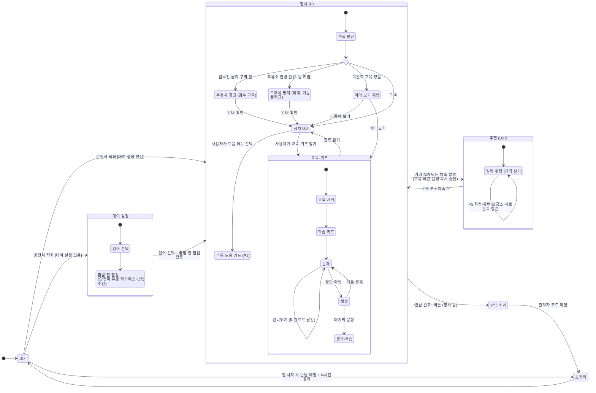

# 전체 상태 머신

노션 "Annyeong Drive 개발 과정 기록" 메인 페이지의 "전체 상태 머신" 섹션을 그대로 옮긴 것이다(2026-11-11 개정판).
원본: https://app.notion.com/p/74f40f22bcf4835b9b798156ec41a121
노션 원본이 바뀌면 이 문서도 함께 갱신한다.

---

**11/11 개정: "외국인 렌터카 11개 기능 실행안"(11/10) 반영.** 출발 전 점검과 교육·퀴즈를 정차 상태에 넣고, 대체 주차장 안내·진입 실패·경로 미리보기·비상등 자동 트리거를 뺐다. 초기화는 착좌 해제가 아니라 반납 처리 완료 시에만 한다(교육 진행은 대여 기간 동안 유지). 오주유 방지는 기능 플래그로 켜고 끌 수 있는 뼈대로 둔다(11/11 결정, 철회 가능). 국가별 차이 안내는 확장 기능이다. 지금은 구현하지 않지만 문구·퀴즈를 (규칙 ID, 언어, 운전 국가) 키로 찾고, 국가가 없으면 언어 기본값으로 떨어지도록 설계한다.

앱 전체는 운전 상태 하나로 움직인다. 입력(차량·내비·위치 이벤트)은 DriveCoordinator가 받아 이 상태 머신에 따라 기능을 하나만 고른다. P 이벤트에 여러 기능이 걸릴 때는 **반납 처리 > 검수된 주정차 금지 구역 > 주유소(오주유 방지, 기능 켜짐일 때) > 미완료 교육 이어 보기 > 일반 정차** 순서로 판단한다. 주행 중 규칙 안내는 주행 상태에서 동작하고, 교육 화면은 정차 상태에서만 열린다.

교육 진입 조건: 기어 P + 차속 0 + UX 제한 없음. 기어 D/R, 차속 발생, UX 제한 중 하나라도 생기면 팝업 없이 교육 화면과 학습 음성을 즉시 닫고, 다음 정차 때 "이어 보기"만 보여 준다.

| 상태 | 들어가는 조건 | 이 상태에서 동작하는 기능 |
| --- | --- | --- |
| 대기 | 앱 시작, 초기화 완료 | 없음 |
| 대여 설정 | 착좌 + 대여 설정 없음 | 대여 시작(언어 선택), 출발 전 점검 |
| 주행 | 기어 D/R 또는 차속 발생 | 주행 중 규칙 안내(P0 보호구역·제한속도·카메라, P1 회전·유턴·요금소·차로 상기), 주행 중 화면 제한 |
| 정차 | 기어 P + 차속 0 | 주정차 경고(검수 구역), 교육·퀴즈, 이어 보기, 수동 도움 카드(P1) |
| 반납 처리 | 정차 중 "반납 완료" 버튼 | 관리자 코드 입력·해시 비교, 오류 잠금 |
| 초기화 | 관리자 코드 확인, 또는 앱 시작 시 반납 예정 시각 + N시간 경과 | 언어·국가 설정, 교육 진행, 안내 기록 삭제. 착좌 해제만으로는 지우지 않는다 |
