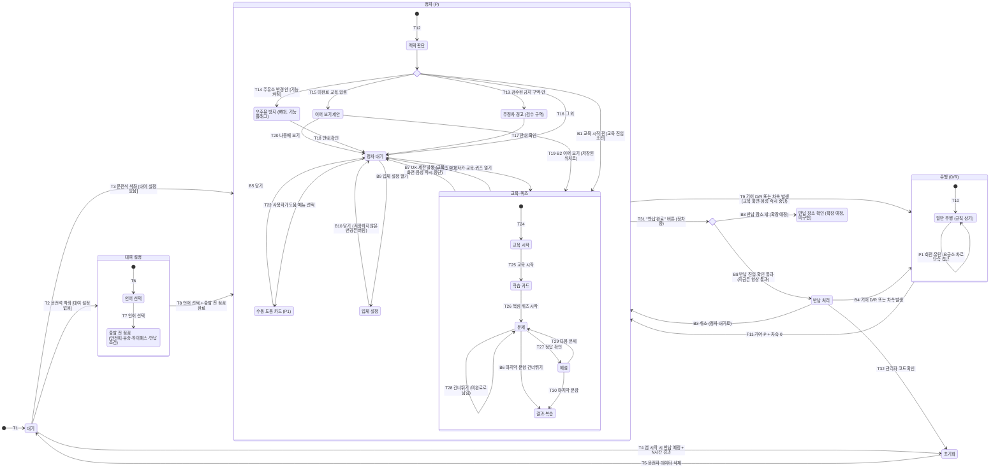

# 전체 상태 머신

노션 "Annyeong Drive 개발 과정 기록" 메인 페이지의 "전체 상태 머신" 섹션을 그대로 옮긴 것이다(2026-11-11 개정판).
원본: https://app.notion.com/p/74f40f22bcf4835b9b798156ec41a121
노션 원본이 바뀌면 이 문서도 함께 갱신한다.

---

**11/11 개정: "외국인 렌터카 11개 기능 실행안"(11/10) 반영.** 출발 전 점검과 교육·퀴즈를 정차 상태에 넣고, 대체 주차장 안내·진입 실패·경로 미리보기·비상등 자동 트리거를 뺐다. 초기화는 착좌 해제가 아니라 반납 처리 완료 시에만 한다(교육 진행은 대여 기간 동안 유지). 오주유 방지는 기능 플래그로 켜고 끌 수 있는 뼈대로 둔다(11/11 결정, 철회 가능). 국가별 차이 안내는 확장 기능이다. 지금은 구현하지 않지만 문구·퀴즈를 (규칙 ID, 언어, 운전 국가) 키로 찾고, 국가가 없으면 언어 기본값으로 떨어지도록 설계한다.

앱 전체는 운전 상태 하나로 움직인다. 입력(차량·내비·위치 이벤트)은 DriveCoordinator가 받아 이 상태 머신에 따라 기능을 하나만 고른다. P 이벤트에 여러 기능이 걸릴 때는 **반납 처리 > 검수된 주정차 금지 구역 > 주유소(오주유 방지, 기능 켜짐일 때) > 미완료 교육 이어 보기 > 일반 정차** 순서로 판단한다. 주행 중 규칙 안내는 주행 상태에서 동작하고, 교육 화면은 정차 상태에서만 열린다.

교육 진입 조건: 기어 P + 차속 0 + UX 제한 없음. 기어 D/R, 차속 발생, UX 제한 중 하나라도 생기면 팝업 없이 교육 화면과 학습 음성을 즉시 닫고, 다음 정차 때 "이어 보기"만 보여 준다.

| 상태 | 들어가는 조건 | 이 상태에서 동작하는 기능 |
| --- | --- | --- |
| 대기 | 앱 시작, 초기화 완료 | 없음 |
| 대여 설정 | 착좌 + 대여 설정 없음 | 대여 시작(언어 선택), 출발 전 점검 |
| 주행 | 기어 D/R 또는 차속 발생 | 주행 중 규칙 안내(P0 보호구역·제한속도·카메라, P1 회전·유턴·요금소·차로 상기), 주행 중 화면 제한 |
| 정차 | 기어 P + 차속 0 | 주정차 경고(검수 구역), 교육·퀴즈, 이어 보기, 수동 도움 카드(P1) |
| 반납 처리 | 정차 중 "반납 완료" 버튼 | 관리자 코드 입력·해시 비교, 오류 잠금 |
| 초기화 | 관리자 코드 확인, 또는 앱 시작 시 반납 예정 시각 + N시간 경과 | 언어·국가 설정, 교육 진행, 안내 기록 삭제. 착좌 해제만으로는 지우지 않는다 |

---

## 보완 전이 (저장소 전용, 2026-11-12)

위 다이어그램은 노션 원본 그대로 두고, 구현하며 드러난 공백을 이 절에 덧붙인다. 노션 기록: 개발 일지 "11/12 설계/구현".
DriveCoordinator와 테스트는 원본 전이(T)와 보완 전이(B)를 모두 따른다. 테스트 KDoc의 근거에는 이 번호를 적는다.

### 확장된 상태 머신

화살표마다 흐름 코드(T: 원본 전이, B: 보완 전이)를 붙였다. 원본과 달라진 전이는 아래 표의 B1~B11이다.
코드에서는 같은 코드를 KDoc의 `상태 머신:` 줄과 분기 옆 주석(`// T7`)으로 달아 둔다. `grep -rnw "T7" app/src`로 구현 위치를 찾는다.

### 보완 전이와 이유

| 번호 | 전이 | 이유 |
| --- | --- | --- |
| B1 | 맥락 판단 → 교육·퀴즈(교육 시작) : 교육 시작 전 [교육 진입 조건] | 결정 문서 3장 "대여 설정이 끝나면 교육 시작 화면을 자동으로 띄운다". 원본대로면 설정 직후 정차에서 "미완료 교육 → 이어 보기"로 가서 "0개 문항을 확인했어요"라는 어색한 제안이 뜬다. 분기 순서는 주유소 다음, 이어 보기 앞이다. 주정차 경고가 교육보다 먼저라는 우선순위를 지키기 위해서다. "나중에 보기"를 고른 뒤에도 교육을 시작하기 전이면 다음 정차에서 다시 교육 시작 화면을 보여 준다 |
| B2 | 이어 보기 → 교육·퀴즈 : 저장된 위치(학습 카드 또는 문제)로 진입 | 원본은 복합 상태의 시작 상태(교육 시작)로 들어가 이어 보기가 처음부터 보기와 같아진다. 부록 B의 "이어 보기 / 처음부터 보기" 구분과 결정 4장의 진행 저장(attempt.position)을 따른다. 정차 대기에서 직접 열 때는 원본대로 교육 시작부터 |
| B3 | 반납 처리 → 정차(정차 대기) : 취소 | 원본은 관리자 코드 확인 말고는 나갈 길이 없다. 운전자가 버튼을 잘못 누르면 코드를 모르는 채로 갇힌다 |
| B4 | 반납 처리 → 주행 : 기어 D/R 또는 차속 발생 | 반납 처리는 정차 중에만 들어가는 정차 전용 화면이다. 코드 입력 중 출발하면 다른 정차 화면처럼 닫고 주행으로 간다 |
| B5 | 수동 도움 카드 → 정차 대기 : 닫기 | 원본에 나가는 전이가 없다. 화면 내용은 P1이지만 상태는 지금 둔다 |
| B6 | 문제 → 결과·복습 : 마지막 문항 건너뛰기 | 원본의 "건너뛰기"는 문제 → 문제뿐이라 마지막 문항에서 갈 곳이 없다. 건너뛴 문항은 미완료로 남고 결과 화면에서 복습 목록에 나온다(부록 B) |
| B7 | 교육·퀴즈 → 정차 대기 : UX 제한 발생 | 원본 본문 "UX 제한 중 하나라도 생기면 교육 화면과 학습 음성을 즉시 닫는다"를 전이로 그렸다. 기어는 P 그대로라 주행으로는 가지 않는다. 이어 보기는 다음 정차 순간에 맥락 판단에서 제안한다 |
| B8 | 정차 → 반납 진입 확인(분기) → 반납 처리 : 확인 통과 / → 반납 장소 확인 : 반납 장소 밖(확장 예정) | 나중에 "지정된 반납 장소에서 반납하는가"를 확인해야 할 수 있다. 조건이 아직 정해지지 않아 지금은 원본대로 "반납 완료" → 반납 처리가 항상 통과한다. 대신 버튼과 반납 처리 사이에 확인 지점(코드의 `ReturnGate`)을 두어, 조건이 정해지면 반납 처리·관리자 코드 흐름을 건드리지 않고 분기만 더한다. "반납 장소 확인" 상태에서 나가는 전이는 조건이 정해지면 그린다 |
| B9 | 정차 대기 → 업체 설정 : 업체 설정 버튼 | 결정 문서 5장의 업체 설정 화면을 정차 대기 화면의 작은 버튼으로 연다(11/13 결정). 업체 설정도 정차 중에만 열리고 출발하면 닫혀야 하므로, 화면이 기어를 직접 보지 않도록 반납 처리처럼 상태 머신 안에 둔다. 코드 입력·처음 코드 정하기·편집·코드 변경 같은 화면 안쪽 단계는 운전 판단과 무관하므로 상태 머신이 아니라 업체 설정 흐름 객체(`VendorSettingsFlow`)가 맡는다 |
| B10 | 업체 설정 → 정차 대기 : 닫기 | 저장 버튼을 누르지 않은 변경은 버린다(11/13 결정). 출발하면 정차 공통 규칙(T9)으로 닫히고, 이때도 저장하지 않은 변경은 버린다. UX 제한(B7)은 교육·퀴즈만 닫으므로 업체 설정은 닫지 않는다 |
| B11 | 일반 주행 → 일반 주행 : 위치 변경 [기어 D/R] / 규칙 상기 | 원본의 "P0 보호구역·제한속도·단속 카메라" 자기 전이에 번호를 붙였다(8단계). 위치가 바뀔 때 구역 데이터로 알려 줄 규칙을 찾고, 찾으면 안내 할 일을 낸다. 기능 보드 "주행 중 규칙 안내" 6번에 따라 기어가 D/R일 때만 말한다(N이나 기어를 모르는 채 차속만 있을 때는 말하지 않는다). 같은 지점 반복과 오래된 위치는 위치 판단·위치 어댑터가 거른다. P1(회전·유턴·요금소·차로) 상기는 기능을 붙일 때 번호를 붙인다 |

### 전이가 없음을 정한 규칙

- 대기·대여 설정 중의 기어 D/R·차속 발생: 상태를 바꾸지 않는다. 주행 중 화면 제한은 AAOS UX 제한이 처리한다.
- 운전석 착좌 해제: 어떤 상태에서도 전이를 만들지 않는다(초기화하지 않음).
- 본문의 "반납 처리 > 검수된 주정차 > …" 우선순위에서 반납 처리는 맥락 판단 분기에 넣지 않는다. 반납 처리는 정차 중 버튼으로만 들어가기 때문이다.
- 교육·퀴즈로 들어가는 모든 전이(B1, 이어 보기, 정차 대기에서 열기)는 교육 진입 조건(기어 P + 차속 0 + UX 제한 없음)을 가드로 갖는다. 조건이 안 되면 B1은 다음 분기로 넘어가고, 사용자 동작은 무시한다.

### 가드 해석 보완 (2026-11-13)

- T29·T30·B6의 "마지막 문항"은 순서상 마지막 문항이 아니라 **지금 문항 뒤에 응답하지 않은 문항이 없는 경우**다. 다음 문제(T28·T29)는 지금 문항 뒤의 응답하지 않은 첫 문항이다.
- 이유: 결과까지 간 뒤 이어 보기(B2)로 건너뛴 문항에 돌아오면, 그 문항을 답하거나 건너뛰었을 때 결과로 가야 한다. 순서상 마지막 기준으로는 상태 머신이 다음 문제로 보내는데 화면 흐름에는 보여 줄 문항이 없어 둘이 어긋난다. 처음부터 순서대로 풀 때는 두 기준이 같다.
- 이어 보기로 들어간 위치의 문항을 이미 답했으면 화면 흐름이 응답하지 않은 첫 문항으로 옮긴다. 모든 문항에 답한 뒤 핵심 퀴즈를 다시 시작하면 새 회차(처음부터 보기, 복습 목록 유지)로 낸다.

### 가드 해석 보완 (2026-11-14)

- T13(검수된 주정차 구역)은 **기어를 P가 아닌 기어(D·R·N)에서 P로 바꾼 순간**에만 판단한다. 앱을 켤 때 이미 P였던 경우(착좌 T3로 들어온 정차)는 구역 근처여도 경고하지 않고 다음 분기로 간다.
- 이유: 기능 보드 "주정차 경고" 5번 "앱 시작 시 이미 P인 상태(첫 값이 P)는 경고하지 않는다". T3도 맥락 판단(T12)을 거치므로, 이 가드가 없으면 구역 근처에서 시동을 걸고 앉기만 해도 경고가 나온다. 같은 자리에서 P → D → P면 다시 경고한다.

### 흐름 코드 (상태 머신 인덱스)

| 코드 | 전이 | 코드 | 전이 |
| --- | --- | --- | --- |
| T1 | [*] → 대기 | T17 | 주정차 경고 → 정차 대기 |
| T2 | 대기 → 대여 설정 | T18 | 오주유 방지 → 정차 대기 |
| T3 | 대기 → 정차 | T19 | 이어 보기 → 교육·퀴즈 |
| T4 | 대기 → 초기화 | T20 | 이어 보기 → 정차 대기 |
| T5 | 초기화 → 대기 | T21 | 정차 대기 → 교육·퀴즈 |
| T6 | 대여 설정 [*] → 언어 선택 | T22 | 정차 대기 → 도움 카드 |
| T7 | 언어 선택 → 출발 전 점검 | T23 | 교육·퀴즈 → 정차 대기 (완료·닫기) |
| T8 | 대여 설정 → 정차 | T24 | 교육·퀴즈 [*] → 교육 시작 |
| T9 | 정차 → 주행 | T25 | 교육 시작 → 학습 카드 |
| T10 | 주행 [*] → 일반 주행 | T26 | 학습 카드 → 문제 |
| T11 | 주행 → 정차 | T27 | 문제 → 해설 |
| T12 | 정차 [*] → 맥락 판단 | T28 | 문제 → 문제 (건너뛰기) |
| T13 | 분기 → 주정차 경고 | T29 | 해설 → 문제 |
| T14 | 분기 → 오주유 방지 | T30 | 해설 → 결과·복습 |
| T15 | 분기 → 이어 보기 | T31 | 정차 → 반납 진입 확인 ("반납 완료") |
| T16 | 분기 → 정차 대기 | T32 | 반납 처리 → 초기화 |
| B1 | 분기 → 교육 시작 (교육 시작 전) | B5 | 도움 카드 → 정차 대기 |
| B2 | 이어 보기는 저장된 위치로 (T19를 보완) | B6 | 문제 → 결과·복습 (마지막 문항 건너뛰기) |
| B3 | 반납 처리 → 정차 대기 (취소) | B7 | 교육·퀴즈 → 정차 대기 (UX 제한) |
| B4 | 반납 처리 → 주행 | B8 | 반납 진입 확인 → 반납 처리 / 반납 장소 확인 |
| B9 | 정차 대기 → 업체 설정 | B10 | 업체 설정 → 정차 대기 (닫기) |
| B11 | 일반 주행 → 일반 주행 (P0 규칙 상기) | | |

일반 주행의 P0 규칙 상기는 B11이다. P1(회전·유턴·요금소·차로) 상기는 기능을 붙일 때 번호를 붙인다.
